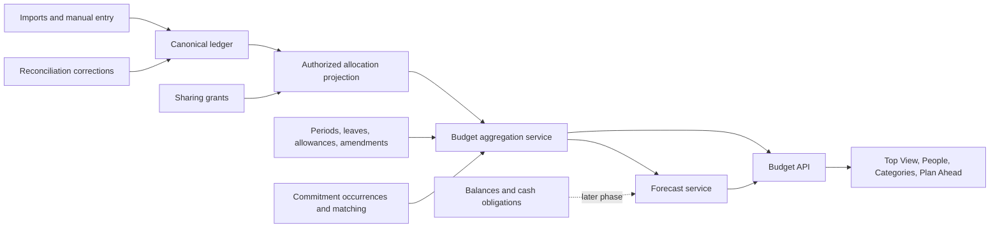

# Household budgeting implementation plan

Status: proposed engineering plan, 22 October 2026. Source: [Household budgeting feature specification](FinWise_Household_Budgeting_Feature_Spec.md). This plan describes work to build; it does not imply the proposed behavior already exists.

Implementation update: attribution, allowance, opt-in commitments, a limited current-month forecast, reviewable amendments, and a basic four-tab budget workspace with allocation drill-down are in code. Family expense/refund allocations may name a household member, Shared pool, or Unassigned; legacy family allocations read as Unassigned. Family plans can set optional People allowances that sum to category limits; personal plans derive their member allowance. `GET /api/v1/budgets/{id}/people` uses authorized ledger allocations and displays each destination's committed and available amounts. Planner items can become dated budget commitments; `GET /api/v1/budgets/{id}/commitments` and tracking report committed amounts and available after commitments. A member explicitly matches one posted expense to one commitment; unmatching restores it. `GET /api/v1/budgets/{id}/forecast` projects the remaining variable daily rate after seven elapsed days, excludes matched posted bills from that rate, and exposes its inputs and quality flags. It is labeled Limited history because source coverage is unknown; earlier dates have no number. Existing budgets use a server-validated before/after preview and reasoned amendment with revision and funding-gap checks; direct PATCH is rejected. Top View, People, Categories, and Plan Ahead tabs now separate the current projections with URL-restored tab state. People and Categories open the exact visible expense/refund allocations through a permission-checked, cursor-paginated endpoint. A basic person-by-category matrix lets either tab narrow to the other dimension before opening transactions; Uncategorized is explicit. This is partial M1–M4 delivery: automatic matching, pending purchases, verified historical forecasting, private-account aggregate sharing, canonical plan migration, and richer tab filters remain open.

## 1. Recommendation and release boundary

Deliver one monthly budgeting read model over the existing canonical ledger. Every expense allocation contributes once to an expense leaf and once to exactly one attribution destination (member, intentional Shared pool, or Unassigned). Category and People views are two projections of those same rows. Payer, initiator, settlement responsibility, funding contribution, and cash movements remain separate dimensions.

The **first usable release** includes Top View, People budget-used table, Categories drill-down, monthly pooled or detailed limits, manual attribution, scheduled commitments, a conservative explained month-end forecast, plan preview/amendments, and server-enforced privacy. It may show `Forecast unavailable` or `Visible subset` when inputs do not support a trustworthy figure. Keep existing Analytics, settlement, and reconciliation workflows working while the new budget surface is rolled out.

Rollover/close, next-month suggestions, attribution rules, matrix, and weekly review form the next release. Cash-aware spend room, cashflow calendar, scenarios, and 12-month outlook follow only after reliable balance and obligation coverage. The spec's acceptance criteria 9 (rollover), 10's cash estimate, and 12 (scenarios) therefore gate those later releases, not the first usable release.

## 2. Current-state findings and gaps

| Area | Present in repository | Required change |
| --- | --- | --- |
| Runtime/UI | Rust/Axum, SQLx/SQLite, and a static JavaScript UI in `web/app.js`; generated API types exist, but there is no Svelte app. | Add budget domain/service modules inside the current monolith and budget UI modules in the current frontend. A Svelte rewrite is not a prerequisite. |
| Ledger | `transactions` are JSON resources; expense/refund allocations have amount, category and personal/family scope. Validation enforces allocation sum in integer minor units. | Add stable allocation identity and a distinct budget destination; preserve existing allocation IDs/mappings on correction, import, split and refund. |
| Plans | One mutable budget resource per month/scope/currency, with category lines, expected income, savings goal, revisions, activate/archive/copy. Tracking derives category actuals. | Introduce one canonical period/tree with member/shared allowances, pooled versus detailed policy, commitments, amendments, funding and period snapshots. |
| Permissions | Transaction visibility requires access to **every** movement account; family allocation from a private account is not currently viewable by another member. Personal allocation is effectively tied to the entering user. | Add allocation-level authorized aggregates and redacted drill-down; define explicit sharing grants. Never expose private account, merchant, count, or inferred amounts through a total. |
| Recurring/planner | Recurring payments are detected patterns and tags; planned items exist. They are not occurrence-based budget commitments. | Create stable planned occurrences and reviewed matching to pending/posted ledger entries. Do not repurpose pattern detection as a payable schedule. |
| Forecast/coverage | Existing reporting labels coverage unknown; budget tracking has planned/actual/remaining, without commitments or forecast. | Introduce coverage evidence and an explained, versioned forecast. Avoid an “on track” claim from unknown coverage. |
| Funding/settlement | Savings/investment and settle-up data exist separately. | Link eligible contribution transfers to targets; keep investment funding and settlement outside expense usage. |

The old [architecture](architecture.md), [analytics/budget module](analytics-and-budgets.md), [API specification](api-spec.md), and [frontend screen specification](frontend-features-and-screen-specs.md) describe some behavior as proposed and differ from the new feature spec. Update their relevant contracts when each milestone is implemented; do not treat them as proof of delivered behavior.

## 3. Architecture and invariants

Keep these services in the Rust modular monolith:

- **Ledger adapter:** emits typed, stable allocation facts from approved transactions only. A statement observation, settlement payment, contribution transfer, card repayment, or investment movement creates no expense fact. Refunds carry a link to the original allocation where available and are recognized in their own period by default.
- **Reporting policy:** resolves household-local date, scope, currency, category mapping, visibility, and data-quality flags. It is shared by Analytics and Budgets so the same request yields identical net spending. `Combined` is the deduplicated union of the viewer's visible Personal and Family facts, not a third independently stored plan.
- **Budget plan service:** owns periods, tree, allowances, funding, amendments, lifecycle, revision checks, and audit. Nodes identify expense categories without duplicating ledger classifications. Parent totals are derived; a detailed parent may contain an explicit Unallocated allowance child. A pooled parent has one allowance and child usage without child limits.
- **Commitment service:** persists dated occurrence IDs and states; matches pending/posted transactions with reviewed identity. An occurrence contributes at most once to `spent + committed`.
- **Aggregation service:** performs the authorized allocation scan once per request/revision and pivots to category/person/summary. It returns `as_of`, plan revision, ledger revision, policy/formula versions, coverage, visibility, and exact drill-down filters. Use indexed SQL projections if measured scans are too slow; do not add a parallel transaction store.
- **Forecast service:** pure, deterministic calculation over aggregate facts, distinct commitments, completed comparable months, exceptions and explicit assumptions. Store formula version/input revision for explainability and reproducibility. Historical suggestions and forecasts are different outputs.

### Hard invariants

1. Within a currency, allocation lines sum to the transaction's net expense amount in integer minor units; deterministic residual assignment handles percentage splits. Never use floating-point money.
2. For a fixed visible scope and revision: member usage + Shared + Unassigned = category-leaf usage = household net usage. Private amounts that are wholly hidden are excluded from the visible total and visibly labeled incomplete.
3. An allocation has one budget leaf and one destination. Category parent and person rows aggregate, never add a second expense. `Paid`, `Initiated`, and `Contributed` are distinct projections with different labels.
4. `effective = planned + opening carry + approved amendments`; `remaining = effective - spent`; `available = remaining - unmatched commitments`; `forecast headroom = effective - (spent + commitments + remaining variable estimate)`. Preserve negative values and negative net spending.
5. Transfers, reimbursements, settlement, reserves and funding do not consume expense allowances. Cash projections later use dated account movements and avoid counting both a card purchase and repayment as cash outflow on the same account.
6. Every read, drill-down, export, matrix cell and count applies the same server-side authorization. A budget permission does not grant account-detail permission.

## 4. Data design and migration

Add normalized SQLite tables for new budget records while retaining the existing `resources` ledger during migration. Every table carries `household_id`; use foreign keys/checks, unique occurrence and allocation identities, and indexes beginning with household/period. Suggested tables: `budget_periods`, `budget_nodes`, `budget_allowances`, `budget_amendments`, `budget_occurrences`, `budget_occurrence_matches`, `budget_funding_plans`, `budget_contribution_links`, `budget_visibility_grants`, `budget_forecast_snapshots`, and `budget_close_snapshots`. A materialized allocation projection is optional after benchmarking; if introduced, update old and new periods atomically on ledger correction and permission change.

The existing budget resource's Personal and Family split needs an explicit compatibility rule. Recommended approach: retain the old resources and API during rollout; create a new household period with scoped branches/allowances for authorized Personal and Family activity, and derive `Combined` as a view. A migration preview maps category IDs to leaves, checks collisions between parent and child limits, and marks ambiguous mappings for review. Import old allowance amounts and revision history as legacy provenance; never infer person usage from account ownership or editor. Historical actuals stay ledger-derived. Existing routes can serve a legacy view until the new UI is ready; writes must have one authoritative path to prevent divergent plans. Give the migration a dry-run report, backup/restore instruction, idempotent execution, and a rollback path before switching writes.

The current ledger has one currency per transaction and only same-currency account movements. For first release, reject unsupported cross-currency budget aggregation with an explicit flag. Source currency, booked conversion rate, and deterministic base-currency split rounding require a separate ledger migration before the spec's foreign-currency criterion can be claimed. Do not silently convert using a current market rate.

Archive member identity rather than deleting attribution. Keep category and node IDs stable across renames. Plan snapshots store the historical tree and rule/formula versions needed to explain a closed period.

## 5. API and UI contracts

Specify versioned endpoints and DTOs in `backend/openapi.json` via `scripts/generate_contract.py`, then regenerate `web/src/lib/api/types.ts`. Extend `/api/v1/budgets` rather than duplicating calculation logic in new routes. Proposed surface:

| Operation | Contract |
| --- | --- |
| `GET /budgets/workspace?month=&scope=&member_id=` | Top View and shared header, one revision/visibility context, four primary values, buckets, People summary, actions and freshness. |
| `GET /budgets/people`, `/categories` | Same context and aggregation; mode and row expansion parameters; no invented allowance on filtered subsets. |
| `GET /budgets/allocations` | Cursor-paginated, permission-checked transaction drill-down bound to the summary revision and filters. |
| `POST /budgets/plan-preview`, `POST /budgets/amendments` | Before/after totals, funding gap, reason, idempotency key and expected plan revision; conflict returns the current diff. |
| `GET/POST /budgets/occurrences`, `POST /budgets/occurrences/{id}/match` | Commitment schedule, state and reviewed match; transaction/occurrence transition is atomic. |
| `GET /budgets/forecast/explanation` | Formula inputs, compared months, excluded bills/exceptions, data-quality flags and version. |
| Later: `/close`, `/restate`, `/suggestions`, `/scenarios`, `/cashflow` | Released only with their milestone's data and privacy gates. |

Use date ranges `[start,end)` in household local time; use stable string money in JSON. Return `Filtered subset` for account/merchant filters and `Visible subset` when hidden data prevents a complete total. Do not compare a subset to a full household allowance as though it were its own budget. Any stale aggregate/commitment combination must refresh together or show a visible stale state.

In the current static frontend, introduce a small budget view/state module, reusing `web/api.js`, URL state, accessible table patterns and existing navigation. The four tabs share month, scope and member filters. Top View is the default; People and Categories drill into the same allocation facts and restore scroll/filter state on return. Plan Ahead begins with current-month explanation and next-month manual plan; hide scenario/cash controls until their APIs exist. Test at phone width and with keyboard/screen reader. Keep Household 360 as a link to Top View, not a second calculation.

## 6. Milestones and exit gates

Effort is a rough sequence for one experienced full-time engineer, including tests and UI work; re-estimate after the first migration/prototype spike. It is not a delivery-date commitment.

| Milestone | Approx. effort | Deliverables and exit gate |
| --- | --- | --- |
| **M0 — contract and migration spike** | 1–2 weeks | Freeze v1 scope/scope semantics, prototype the five spec edge cases, inventory existing budget resources, design new DTOs/schema and dry-run migration. Review privacy sharing choices and obtain representative synthetic fixtures. Exit: written migration mapping and invariant tests agreed. |
| **M1 — allocation and privacy foundation** | 3–5 weeks | Stable allocation IDs/destinations, Unassigned/Shared, authorized aggregate projection, server redaction, account/payer/initiator separation, refund/transfer exclusion, reconciliation correction hooks, migration preview. Exit: split, category and member totals reconcile; direct URLs/counts/exports cannot leak private detail. |
| **M2 — canonical monthly plan** | 2–3 weeks | Period/tree/allowances, pooled/detailed rules, manual setup, funding section, preview, balanced amendments, revisions and idempotent conflict behavior. Exit: parent/child and member allowances reconcile; ₹2,000 move preserves total and is auditable. |
| **M3 — first budget workspace** | 2–3 weeks | Top View, People used/paid/initiated/contributed modes as supported, Categories drill-down, route/filter restoration, mobile/accessible states, freshness and data-quality labels. Exit: three-selection drill-down, no double count, no unsafe private drill-down. |
| **M4 — commitments and explained forecast** | 3–4 weeks | Occurrence lifecycle and matching, pending purchase handling, rate forecast, limited-history fallbacks, explanation, actionable overrun alerts. Exit: scheduled→pending→posted remains one ₹2,000 obligation; leap-month and stale/missing-history fixtures pass. This completes the first usable release. |
| **M5 — planning expansion** | 3–5 weeks | Rollover/close/restate, irregular sinking funds, next-month median suggestions, attribution defaults/undo, optional person-category matrix and weekly review. Exit: late corrections propagate through carry with preserved snapshots; suggestions expose source months and exceptions. |
| **M6 — cash and scenarios** | 4–6 weeks | Dated cash obligations, balance-anchor coverage, card debt reserve, cashflow calendar, spendable-cash guardrail, draft/apply scenarios, 12-month outlook. Exit: unknown/stale anchors suppress spend room; scenario apply changes a revision only; cash and budget totals stay distinct. |
| **M7 — release hardening** | 1–2 weeks, overlapping | 100k-transaction/10-member benchmark on documented NAS hardware, SQLite indexes/projections as needed, browser/device accessibility and usability check, backup/restore migration rehearsal. Exit: measured p95 summary/initial-view targets or documented revised targets, plus privacy and reconciliation regressions passing. |

Dependencies: M1 precedes M2–M4; M2 and M3 can overlap after the shared DTO is stable; M4 requires both M1 and M2. M5 builds on a working M4 forecast and plan lifecycle. M6 depends on verified balance anchors and account-level obligation data, not just the budget UI. M7 checks run per milestone, with the large-scale benchmark near release.

## 7. Verification plan

Build synthetic integration fixtures for the spec's ₹4,000 50/50 shared purchase (payer versus usage and reimbursement), private purchase funded by a shared account, ₹5,000 card purchase/repayment, ₹2,000 occurrence transition, refund across month boundary, three-way minor-unit rounding, pooled/detailed allowance, missing category/person, and timezone boundary. Assert identical totals from summary, People, Categories, Analytics and drill-down at the same revision. Add adversarial permission tests for aggregate, matrix, URL, search, count and export surfaces. Test concurrent amendment revision conflicts and replayed idempotency keys.

Forecast tests use exact calendar lengths, complete/incomplete comparable months, scheduled bill exclusion, pending variable activity, exceptional purchases and unavailable states. Close/restate tests belong to M5; cash-anchor and scenario tests belong to M6. Browser checks cover 320 px layout, keyboard expansion, labels, negative values, filter restoration and screen-reader table semantics. The first usable release should also run the spec's moderated five-user comprehension check before claiming the ten-second goal.

Run `cargo fmt --all --check`, `cargo clippy --locked --workspace --all-targets -- -D warnings`, `cargo test --locked --workspace`, `python3 scripts/generate_contract.py --check`, and `node --test web/tests/*.test.cjs` for affected implementation slices. Benchmark only after realistic indexed data and a documented reference machine exist.

## 8. Decisions to settle in M0

| Decision | Recommended default | Why it matters |
| --- | --- | --- |
| Relationship to old Personal/Family budgets | One canonical period/tree with scoped branches; Combined remains a derived authorized view. | Prevents two plan systems from disagreeing while preserving current navigation. |
| Household default | Calendar month, household timezone/base currency, Family Top View. | Aligns existing date model and the spec's quick check. |
| Attribution default | Budget used; unknown destination is Unassigned; Shared is explicit. | Avoids inventing beneficiary from payer/account owner. |
| Private-account sharing | Explicit `excluded`, `aggregate only`, or `full detail` grant, default excluded. | Determines whether a complete household total may be shown and blocks inference leaks. |
| Refund policy | Credit period received; prior-period restatement requires an audited choice. | Keeps ordinary ledger corrections deterministic. |
| Forecast quality | No numeric forecast without adequate history or explicit estimate before day eight. | Makes missing data visible instead of presenting false precision. |
| Multi-currency | Base-currency budgets only until booked-rate support is delivered. | Current ledger forbids mixed-currency movements. |
| Approval | Every amendment needs preview, reason and explicit save; additional household approval is optional. | Keeps edits auditable without blocking a small household's workflow. |

## 9. Risks to track

- **Privacy and completeness:** aggregate-only private sharing can still leak information by subtraction across filters or time windows. Define allowed aggregation granularity and suppress unsafe cells/counts before shipping M1.
- **Resource-store performance:** current JSON-resource scans may not meet the spec's 100k-transaction target. Measure early; add a transactionally maintained indexed projection only where the benchmark shows a need.
- **Historical mapping:** parent/child budget lines and renamed categories may not map cleanly. The preview must require review rather than assigning fabricated limits or member shares.
- **Duplicate obligations:** recurring pattern detection is observational, not an authoritative schedule. Only reviewed occurrences participate in commitments and matching.
- **Coverage quality:** import recency does not establish complete history. Forecast and cash gates require explicit evidence; otherwise show the recorded amount and its limits.
