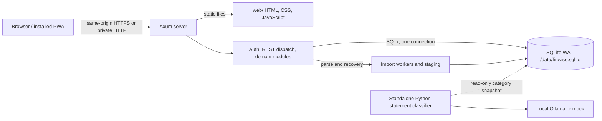
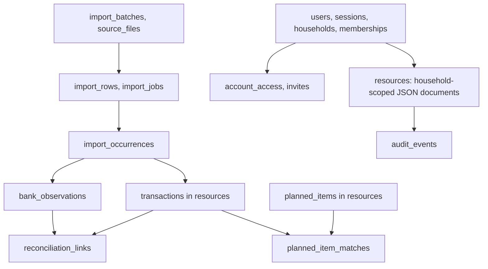

# FinWise overview and system architecture

**As of 23 October 2026.** This document describes the repository implementation first and labels future design separately. It is intended for product review, engineering handoff, and integration planning.

## 1. What FinWise does

FinWise is a self-hosted personal and household finance application. Members can maintain accounts and a transaction ledger, import Money Manager workbooks and bank statements, reconcile source evidence with ledger entries, track balances and budgets, inspect analytics, manage planned expenses, record settle-up obligations, and track basic investment records. Personal and family scopes coexist with account-level visibility rules. The current web app is a static JavaScript application with a PWA shell.

The app does not connect to banks or initiate payments. A separate Python/Ollama statement-classification prototype exists in `ai-service/`; it is not wired into the main API or deployment.

## 2. Current deployment and components

| Part | Current implementation | Main files |
| --- | --- | --- |
| Frontend | Static HTML/CSS/vanilla JS, Chart.js asset, service worker with offline fallback | `web/index.html`, `web/app.js`, `web/api.js`, `web/service-worker.js` |
| HTTP server | Rust Tokio + Axum; one origin for API and web assets | `backend/src/main.rs`, `backend/src/lib.rs`, `backend/src/api.rs` |
| Data access | SQLx/SQLite; WAL, foreign keys, 10-second busy timeout, one pooled connection, startup migrations | `backend/src/lib.rs`, `backend/src/storage.rs`, `backend/migrations/` |
| Domain modules | Auth, ledger validation, imports, reconciliation, balance checks, planning/forecast, recurring labels, widgets, reset | `backend/src/` |
| Contract | OpenAPI 3.1 and generated browser types | `scripts/generate_contract.py`, `backend/openapi.json`, `web/src/lib/api/types.ts` |
| Deployment | Multi-stage Docker image and Compose volume `/data`; app serves port 3000 | `deploy/Dockerfile`, `deploy/compose.yaml` |
| Optional AI prototype | Separate Python upload page and CLI; local category snapshot, no production API integration | `ai-service/` |

The API base is `/api/v1`. `/health/live` and `/health/ready` are also exposed at root. An unknown API path returns JSON `404`; frontend navigation falls back to `index.html`. Docker Compose currently publishes port 3000 on all interfaces by default and permits insecure HTTP cookies for a trusted private network; use a private HTTPS proxy for secure cookies and full PWA behavior.

## 3. Data architecture

The physical schema has **25 tables and 19 explicit indexes**. Identity, upload staging, deduplication, bank observations, reconciliation links, and some settings have relational tables. Many domain objects reside in one `resources` table with `kind`, `household_id`, `owner_id`, `revision`, and a JSON `document`. Accounts, categories, transactions, budgets, planned items, reconciliation sessions/matches, balance checks, settle-up obligations, and investments use this document pattern. The [schema export](db-schema-export.md) enumerates every physical column and constraint. API component schemas describe the public JSON shapes.

This is a constrained ledger, not a general double-entry accounting system. A transaction stores signed account movements and separate category allocations. Expense/income/refund allocations must sum to the transaction magnitude; a transfer has two distinct accounts, opposite movements, and no expense allocation. Money is parsed from decimal strings to checked integer minor units, with explicit supported currency precision. This keeps transfers and repayments from inflating spending totals.

### Source evidence and mutation flow

1. Upload creates a batch, original `source_files.bytes`, staging rows, and durable import jobs. Money Manager XLSX and bank CSV parsers normalize rows; source profiles and aliases map labels to canonical resources.
2. Commit uses fingerprints and occurrence records to avoid duplicate canonical entries. Bank observations remain source claims, separate from user-approved transactions.
3. Reconciliation sessions compare ledger account movements with bank observations. Accepted matches are represented by `reconciliation_links`; corrections and closed-period decisions carry revisions and audit history.
4. Reports and budgets read authorized ledger transactions and derived allocations. Planned items can be matched to posted transactions so commitments are not counted twice.

Original files are stored as SQLite BLOBs, not as a separate private file volume. `source_files`, `import_rows`, and `bank_observations` are distinct from canonical `resources` transactions. This separation matters when a source row is reclassified or a ledger transaction is corrected.

### Scope and privacy

Every resource lookup is household scoped. Account access is based on ownership, shared visibility, or `account_access`; a transaction is visible only when all its movement accounts are visible to the caller. Budget visibility depends on owner or family scope. Current family totals therefore have a coverage limit when transactions involve another member's private account. A family label must not imply complete household spending when private activity is excluded.

The main server uses hashed session tokens in `sessions`, Argon2 password hashes, HttpOnly cookies, and a CSRF header for mutations. Roles are owner/admin/member. Mutations run in a SQL transaction and write audit events; retryable POST requests use idempotency keys. The service worker caches the offline page only and skips API requests. The browser keeps CSRF and retry keys in memory and has a short in-memory cache for some reads.

The separately enabled anonymous quick-expense and widget routes are exceptions to session authentication. They are intended for a trusted private network and must be considered when choosing proxy exposure.

## 4. API architecture

The [OpenAPI export](openapi.json) includes **147 paths, 180 operations, and 106 component schemas**. Its `x-implemented` extension marks 162 operations implemented and 18 deferred. Deferred protected routes return `501 not_implemented`; a declared implemented route can still represent a narrower feature than a later product specification. The [route catalog](api-spec-export.md) lists each endpoint and status.

Functional surfaces include auth/household, accounts/categories/ledger, imports/jobs, bank statements and reconciliation, analytics, budgets/planned items/forecast, settle-ups, investments, settings, data reset, quick expense, and widgets. The server publishes the current contract at `/api/v1/openapi.json`. `scripts/generate_contract.py` generates both the JSON and TypeScript DTOs; the static frontend is not a Svelte application despite the older proposed architecture document.

Request rules to preserve: decimal-string money, local business dates, CSRF for cookie-authenticated mutations, revision checks on editable resources, idempotency on replayable POSTs, household-scoped authorization, and stable JSON error envelopes with a request ID. File upload is multipart; job progress can be read as server-sent events.

## 5. Budget workspace: delivered and proposed

The current implementation has monthly budgets, category limits, personal/family scope, tracking and amendments, member attribution for family allocations, optional People allowances, planned-item commitments and explicit matching, a limited current-month forecast, People and category allocation drill-down, and a basic person/category matrix. The frontend has Top View, People, Categories, and Plan Ahead tabs with URL-restored tab state. The forecast uses a simple variable daily rate after seven elapsed days and exposes quality flags; source coverage remains unknown.

The October 2026 [household budgeting spec](../FinWise_Household_Budgeting_Feature_Spec.md) proposes a more complete canonical budget tree and member model. Its core design is to count each expense allocation once, then project those same records by category or person. It distinguishes **budget used**, **paid by**, **initiated by**, **member contribution**, and **settlement liability**. An intentional Shared pool and an Unassigned bucket are separate. Effective allowance, spent, commitments, remaining, available after commitments, forecast spending, and forecast headroom are distinct measures.

### Recommended screen hierarchy

| Screen | Design intent |
| --- | --- |
| Top View | Month/scope and coverage first, then effective allowance, spent, available after commitments, forecast headroom, broad buckets, people summary, and a few inspectable actions. |
| People | Default to budget usage; explicitly switch to paid, initiated, or contributed metrics. Expand a member to category and transaction evidence. |
| Categories | Expand bucket → category → subcategory → transactions; distinguish pooled limits from detailed child limits and show unallocated allowance explicitly. |
| Plan Ahead | Show reviewed commitments, forecast inputs and quality, upcoming obligations, and later cashflow/scenario views. |

Mobile should put available after commitments and forecast headroom first, keep negative amounts visible, and preserve filters while drilling down. Charts and percentages should state period and coverage. A private-account aggregate should be released only after the privacy policy defines safe aggregation and suppression of inferable cells.

### Work still proposed

The feature spec and implementation plan call out canonical plan migration, automatic commitment matching and pending purchases, verified historical forecast coverage, private-account aggregate sharing, detailed parent/unallocated rules, rollover/close, funding contribution links, cash-aware spend room, scenarios, and longer-range outlooks. Some planned API routes are explicitly deferred: contribution targets/links and budget alerts. These should be implemented with new migrations and contract changes rather than inferred from the current JSON resources.

## 6. Investment design boundary

The current API has investment records, monthly values and contributions, SIP processing, and links to existing transactions. Investment records live in `resources`, not a normalized holdings/lots/valuations schema. The newer [investment product spec](../FinWise_Investment_Module_Product_Spec.md) proposes holdings, SIP occurrences, activity, dated valuations, ownership shares, goals, funding links, and a review queue. It also requires portfolio math that distinguishes outside funding from internal purchases and cash, treats missing valuations as unknown, and labels return measures by their data coverage. Those proposed entities and calculations are not implied by the present SQL or API.

An eventual investment implementation should keep bank funding evidence, portfolio cash, holdings, valuations, and goals separate. A broker-wallet transfer followed by a purchase is one external contribution, not two. Opening value is a tracking baseline, not current-month funding. Manual values should retain as-of date and source; missing values should never be treated as zero.

## 7. Architectural decisions and consequences

| Decision | Why it fits now | Consequence / next trigger |
| --- | --- | --- |
| Modular Rust monolith | One NAS service and one deployment path make authentication, imports, ledger changes, and audit transactions easier to coordinate. | Keep domain boundaries in modules; split services only if operational need appears. |
| SQLite with WAL and one pooled connection | Simple private deployment and serialized revision/idempotency writes. | Benchmark realistic large ledgers; add indexed projections or adjust connection strategy when measured contention warrants it. |
| Hybrid relational + JSON resource store | Core identity/import relationships have SQL constraints while product objects can evolve quickly. | JSON references and nested invariants require Rust validation; generated contract and migration snapshots must stay synchronized. |
| Source observation separate from ledger | A bank row can confirm an existing expense without posting a second one. | Keep import provenance and reconcile links when correcting canonical transactions. |
| One origin for frontend and API | Simplifies cookies, CSRF, PWA install, and NAS deployment. | Proxy configuration must handle HTTPS and must not expose anonymous optional routes broadly. |
| Static JavaScript UI | Matches the actual shipped app and avoids a frontend build server. | Older Svelte design notes are aspirational; a framework rewrite should be justified by a concrete maintenance need. |
| Deterministic import/reconciliation core | Financial records remain reviewable and usable with AI disabled. | Optional model suggestions must never silently post ledger changes. |

## 8. Open decisions and engineering risks

- **Household coverage:** define aggregate-only private sharing and guard against revealing hidden amounts through filtered totals or subtraction before presenting complete combined reports.
- **Budget migration:** decide how existing personal/family plans map to a single canonical period/tree without duplicate allowances or altered history.
- **Forecast evidence:** define sufficient import coverage, comparable history, pending transactions, and stale-data rules before claiming reliable projections.
- **Ledger scale:** `resources` JSON scans and per-transaction authorization may become expensive. Use measured workloads before adding projections or caching sensitive aggregates.
- **Investment accounting:** define canonical holdings, external funding, portfolio cash, valuation policy, ownership, and cost-basis rules before claiming returns or household wealth totals.
- **Backup/restore:** operations endpoints are deferred. A documented SQLite backup/restore rehearsal is needed before relying on in-app recovery.

## 9. Where to change the system

| Change | Required files/checks |
| --- | --- |
| SQL storage | Add an ordered file under `backend/migrations/`; update Rust data access and refresh `db-schema.sql` plus the schema dictionary. |
| API DTO or route | Edit `scripts/generate_contract.py`, server handler/domain module, then regenerate `backend/openapi.json` and `web/src/lib/api/types.ts`; refresh this API export. |
| Product behavior | Update the relevant module doc, contract, authorization tests, and frontend flow so labels match actual coverage. |
| Deployment policy | Review `deploy/compose.yaml`, cookie flags, private network/HTTPS proxy, and anonymous shortcut/widget settings. |

Useful checks already used by the repository: `python3 scripts/generate_contract.py --check`, `cargo test --locked --workspace`, and `node --test web/tests/*.test.cjs`. The schema snapshot can also be replayed into an empty in-memory SQLite database for structural verification.
